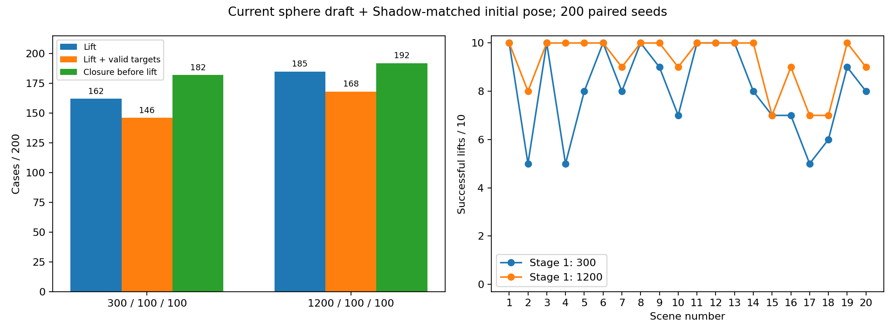

# Adopted Sharpa specification — 2026-11-02

The user adopted the latest sphere geometry and initial joint configuration,
explicitly retaining **300/100/100** optimization steps. The 1200-step study is
comparison evidence only. Select suite `sim_sharpa_50_restored.yml`, manipulator
`sim_sharpa/tabletop_full_50_restored.yml`, and robot
`right_sharpa_wave_50_tip_contact.yml`. The generic 34-sphere preset is separate.

`specification.json` records exact runtime joint order, initial angles, sphere
checksum, iteration schedule and controller: **kp=7.5, kv=0, damping=0.05**.
Controller values are implemented in the sibling DexGraspBench repository and
were verified in every physical trial; this adoption does not modify them.

Four fingers have MCP flexion 0.3 rad; index/middle/ring/pinky abduction is
−0.1/0/0.1/0.2 rad. Their PIP/DIP and pinky CMC remain zero. Thumb CMC_FE,
CMC_AA, MCP_FE, MCP_AA, IP are approximately
1.00935/−0.34910/−0.16871/−0.09500/0 rad, within existing limits.

All 50 spheres come from the tested complete geometry snapshot, including the
four-finger continuous chain, DP/contact fit and thumb MC/PP/DP/contact fit.
The five elastomer attraction targets, DP contact eligibility, final −2 mm
DP/pad clearance, world/self weights 100 and collision exclusions are retained.
Meshes, joint axes/limits and palm-to-flange convention are unchanged.

## Paired evidence

| Metric / 200 candidates | Adopted 300 steps | Comparison 1200 steps |
|---|---:|---:|
| Lift success | 162 (81%) | 185 (92.5%) |
| Lift and all targets legal | 146 (73%) | 168 (84%) |
| Pre-lift six-dimensional closure | 182 | 192 |
| Squeeze limit violations | 19 | 17 |
| MuJoCo warnings / pre-simulation rejections | 0 / 0 | 0 / 0 |
| Generation wall time including load/logging | 69.7 s | 178.5 s |

Both use the same 200 initial tensors (20 scenes × 10), the current nonzero
joint pose and identical geometry. Later stages remain 100/100. Increasing
stage 1 to 1200 improved 27 and regressed 4 seeds: +11.5 percentage points,
scene-bootstrap 95% interval [+6.5, +17.5]. Each budget ran once; GPU trajectories
are not guaranteed bitwise reproducible. These scenes were selected from
historical failures and do not estimate the full 600-case success rate.
Relative to the preceding 119/200 result, both thumb geometry and initialization
changed, so that difference does not isolate either cause.

The sphere chain remains an approximation, not a full mesh enclosure or proof
of force closure. Thumb MC/PP coverage decreased to about 78.4%/69.2% while
reducing overhang. Squeeze extrapolation is not clipped and can exceed limits.
Closure metrics use actual pre-lift loaded contacts, excluding the table;
ideal gravity capacity does not prove dynamic or joint-torque feasibility.



## Files and verification

- `specification.json`: adopted exact configuration contract.
- `study_summary.json`, `paired_cases.csv`, `study_verification.json`: measured
  outcomes and runtime audits at the time of the study, before adoption.
- `thumb_geometry.json`, `four_finger_contact_geometry.json`: fit metrics and
  original local-workspace provenance; absolute source paths are historical.
- `formal_runtime_verification.json`: normal solver loading after adoption,
  including actual sphere tensors, seed values and collision policy checks.

From BODex, with dataset environment variables configured:

```bash
.venv/bin/python scripts/verify_sharpa_50.py \
  --scene-manifest /path/to/one_scene.txt \
  --output /tmp/sharpa_formal_verification.json
```

The original experiment scripts, seeds, generated grasps, logs and contact
recordings remain workspace-local under
`reviews/sharpa_thumb_pose_iterations_200/`; they are not included in this
commit. Historical test snapshots remain immutable. The current formal files
and `specification.json` define the adopted specification.
