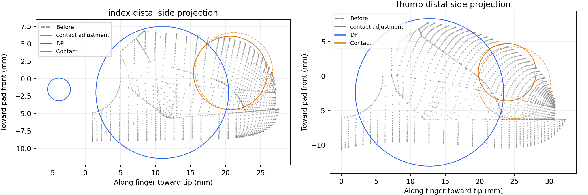

# Sharpa project state — 2026-11-01

The retained right-hand research preset is **50 spheres with PP correction and
five refined elastomer contact spheres**. Select `sim_sharpa_50_restored.yml`.
The generic `sim_sharpa.yml` entry remains the earlier 34-sphere preset; no default
switch is made by this cleanup. Shadow configuration and evaluation remain intact.

## Selected configuration

All configuration paths below are relative to `src/curobo/content/configs/`.

| Role | File / value |
|---|---|
| Suite | `manip/sim_sharpa_50_restored.yml` |
| Manipulator | `manip/sim_sharpa/tabletop_full_50_restored.yml` |
| Robot | `robot/right_sharpa_wave_50_tip_contact.yml` |
| Spheres | `robot/spheres/right_sharpa_wave_50_tip_contact.yml` |
| Optimization task | `task/gradient_grasp_fc.yml` |
| World / self collision weight | 100 / 100 |
| Attraction targets | Five elastomer `/0` spheres |
| Additional contact-eligible links | All five DP links, final clearance −2 mm |
| Initial joints | All 22 zero; mild-flex trial was not adopted |
| Surface-pose transfer | `robot/hand_pose_transfer/right_sharpa_wave_s34.yml`, translation `[0, 0.01, 0.0989]` |
| Geometry changes | 12 PP spheres + 5 contact spheres; DP geometry unchanged |

The sphere total is **45 non-attraction spheres + 5 attraction spheres**.
Both sets participate in collision handling. DP eligibility changes the soft
clearance, not the five grasp-attraction targets or the self-collision exclusions.
Canonical URDF joint ordering, axes, limits and kinematics are preserved.

Contact centers/radii below are in each elastomer link's local frame, in mm:

| Fingers | x | y | z | r |
|---|---:|---:|---:|---:|
| Index, middle, ring, pinky | −0.975931 | −20.670307 | −0.817575427 | 5.2571423 |
| Thumb | 0 | −23.953850 | −0.564571292 | 4.1717488 |

The pad-facing direction is local −Z. Center-ray protrusion is 0.400 mm;
this does not bound the entire sphere's protrusion from the curved mesh.



## Recorded results and limitations

Two matched-initialization runs of 20 candidates on one bottle:

| Configuration | Lift A / B | Lift + all-stage limits A / B | Max static object penetration A / B | Max static self penetration A / B |
|---|---|---|---|---|
| Previous PP baseline | 9/20, 8/20 | 8/20, 7/20 | 3.055, 4.945 mm | 3.242, 5.296 mm |
| Retained contact refinement | 10/20, 11/20 | 7/20, 9/20 | 3.391, 2.834 mm | 6.846, 5.145 mm |

All 120 new fingertip-ablation replays completed 750 steps without numerical
warnings. These are historical results, not new runs during commit preparation.
Only one object was tested. Worst self penetration increased; successful lifting
does not establish collision-free full evaluation readiness. Penetration is from
MuJoCo collision proxies, not exact CAD geometry. Original squeeze extrapolation
`2*grasp-pregrasp` can exceed limits; it was not silently clipped. See
[versioned evidence](sharpa_evidence/README.md) for raw summary values and provenance.

The corrected surface-pose transfer was evaluated on one scene each of bottle,
mug, and camera with ten candidates per scene. It lifted 6/30, versus 3/30 for
the earlier Sharpa transfer on those same scenes and 27/30 for historical Shadow.
Five of the six new lifts also had all three commanded stages within joint
limits. Candidate seeds and optimization trajectories were not paired, so the
small comparison does not establish a causal lift-rate improvement. Detailed
results and reproduction commands are in the workspace-local
`benchmarks/sharpa_transfer_small/README.md`.

## Configuration history

Historical configs are retained because existing comparisons and viewers reference
them. They are not alternate definitions of the current retained geometry.

| Robot/sphere suffix | Status |
|---|---|
| `sim` / `s34` | Generic 34-sphere preset, separate baseline |
| `50_restored` | Frozen original 50-volume geometry |
| `50_pp_refined` | Intermediate PP-only correction |
| `50_tip_contact` | **Retained: PP correction + contact refinement** |
| `50_tip_dp`, `50_tip_combined` | Evaluated candidates, not adopted |
| `50_manual` | Historical manual contact editing trial |
| `50_volume_preview`, `50_shadow_seed_preview` | Historical geometry previews |
| `*_kinematics` | Left/right flange-root validation fixtures, not synthesis |

`gradient_grasp_fc_sharpa_50.yml` is the historical weight-10 ablation; the selected
50-sphere preset uses the shared weight-100 task. `sim_sharpa_s34_distal.yml` is a
separate 34-sphere contact-definition trial. Existing filenames are retained to
avoid invalidating stored commands and experiment identities.

## Repository boundaries

Keep these four repositories as siblings:

- `HUGS-Sharpa-Assets`: canonical left/right URDFs, meshes, provenance, source
  notices and independent FK validation. Required by the other three repositories.
- `HUGS-BODex`: synthesis configs, collision/contact proxies, initialization,
  smoke diagnostics and this selected-preset evidence. Right-hand synthesis only;
  both hands have kinematics validation.
- `HUGS-DexGraspBench`: left/right MJCF, Bench-local palm decomposition and
  controllers, motion/contact validation, smoke evaluation and preview tools.
- `HUGS-DexLearn`: left/right FK/mesh configs and checks. No Sharpa training or
  complete learned-inference pipeline is claimed.

Workspace `reviews/`, `benchmarks/`, `Sharpa_content/`, `agent_tasks/` and
`third_party_build/` remain local. Preserve them separately if exact historical
experiments are needed. The supplied configuration source was adapted to preserve
canonical limits; the shared asset repository records original model provenance.

## Verification and use

From BODex with its environment and the shared assets installed:

```bash
.venv/bin/python scripts/check_sharpa_assets.py
.venv/bin/python scripts/validate_sharpa_synthesis.py
# Set HUGS_DATASET_ROOT / HUGS_OBJECT_ROOT for your dataset installation.
.venv/bin/python scripts/verify_sharpa_50.py \
  --scene-manifest /path/to/one_scene.txt \
  --output /tmp/sharpa_active_verification.json
```

The last command constructs the normal Sharpa and Shadow solvers and inspects
actual rollout weights/contact allowances; it does not generate grasps. The first
two check both-hand CPU FK and generic 34-sphere CUDA initialization respectively.
The selected 50-sphere suite can be passed to `scripts/run_sharpa_smoke.py` as shown
in [the contact configuration notes](sharpa_50_contact.md).

Generated root poses refer to the palm. Bench expects the flange:
`p_flange = p_palm - R @ [0, 0, 0.0295]`. Apply only to identified palm-root data
and verify world FK; do not convert old flange-root records again. The general
Bench formatter does not infer this distinction. Historical conversion drivers
are retained with their runs in the local workspace.

The SSH three-hand initialization preview currently uses port **8089** and lets
the user compare the corrected Sharpa transfer with its previous value. The
existing static media service on **8088** remains separate. Historical
sphere-preview CLI modes display their explicitly selected older configurations;
they do not implicitly show the retained contact-refinement preset.
